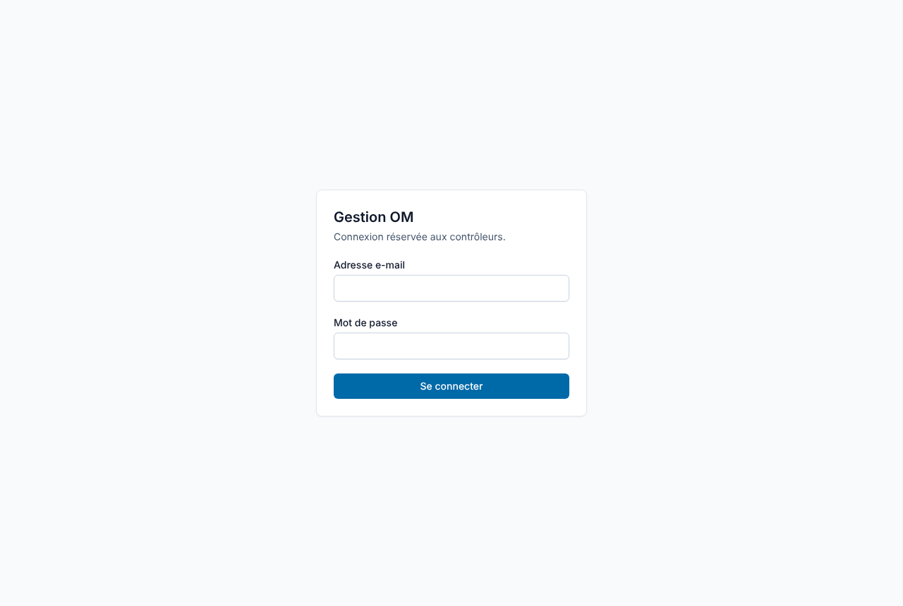
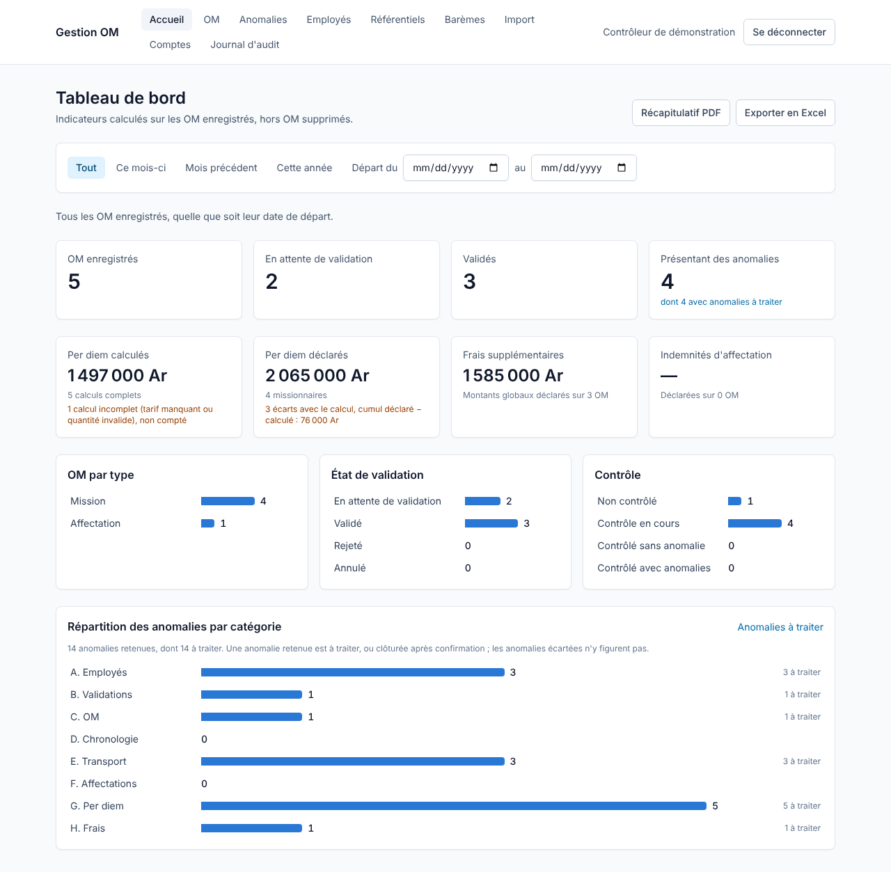
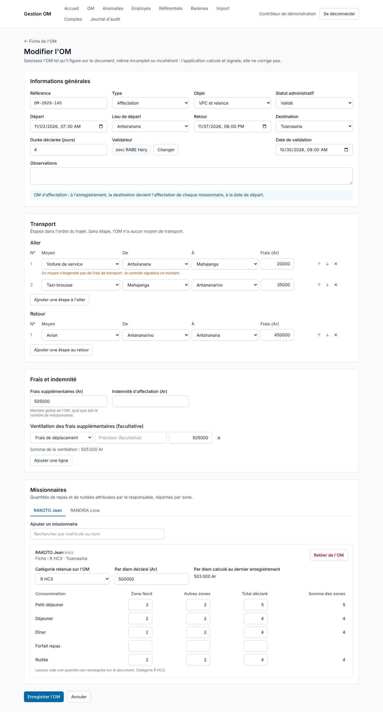
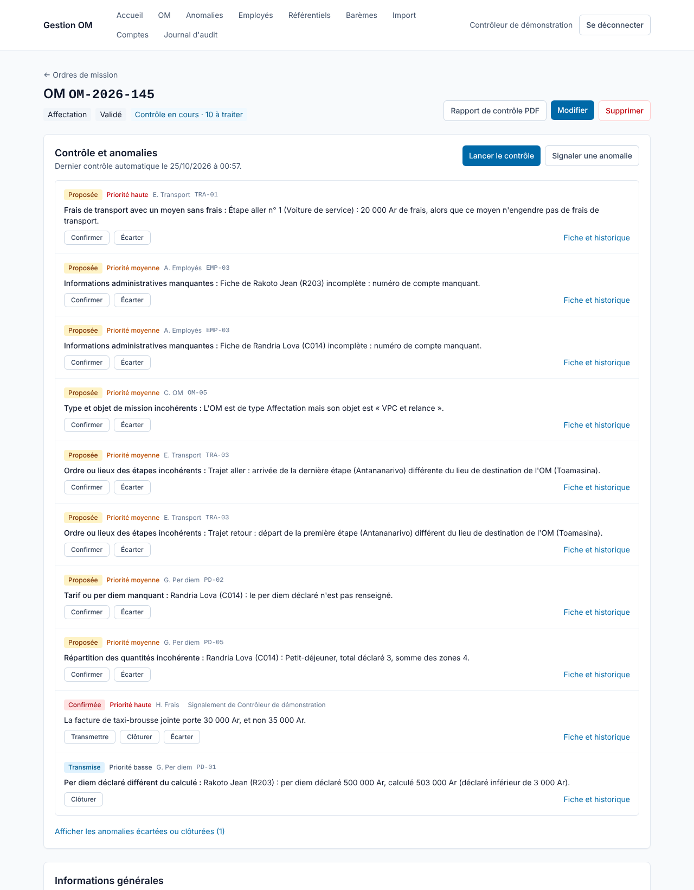
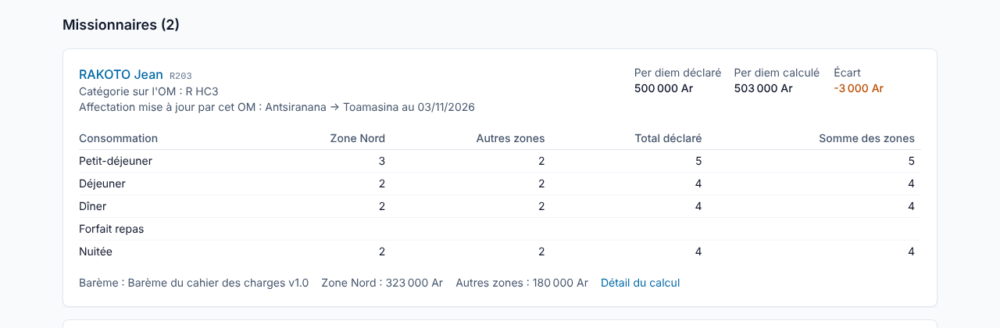
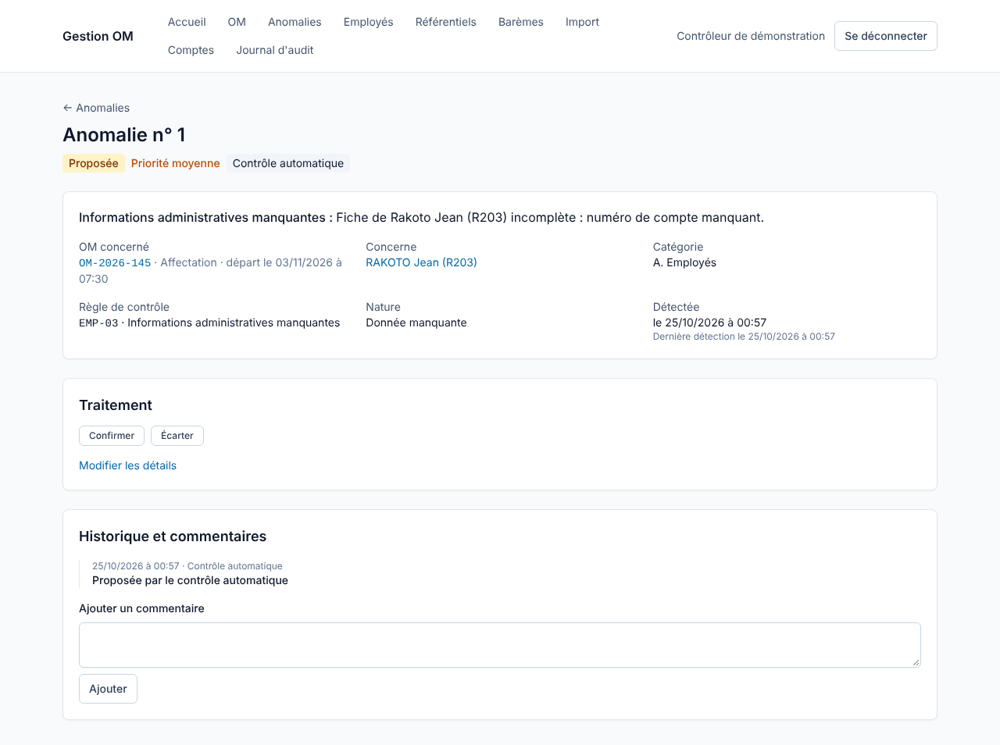
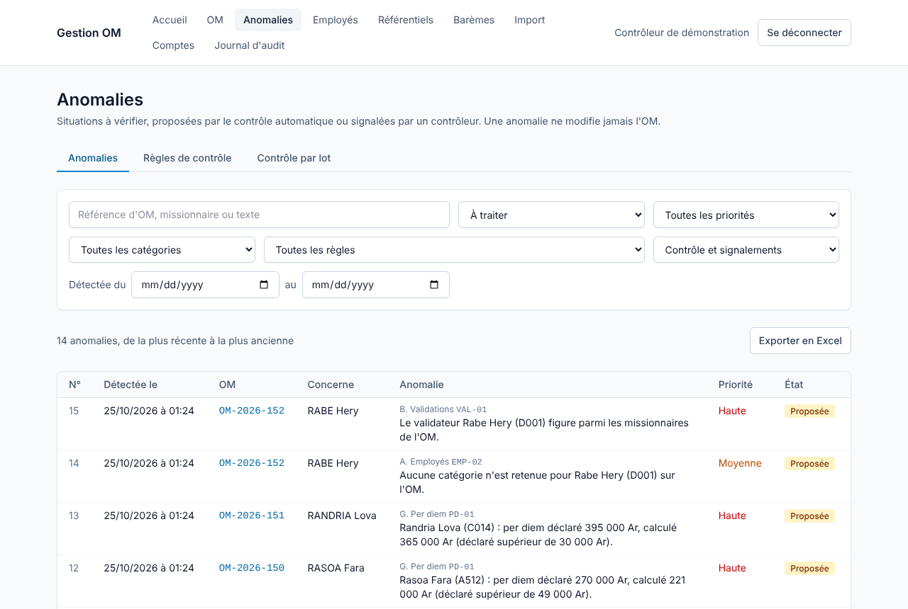
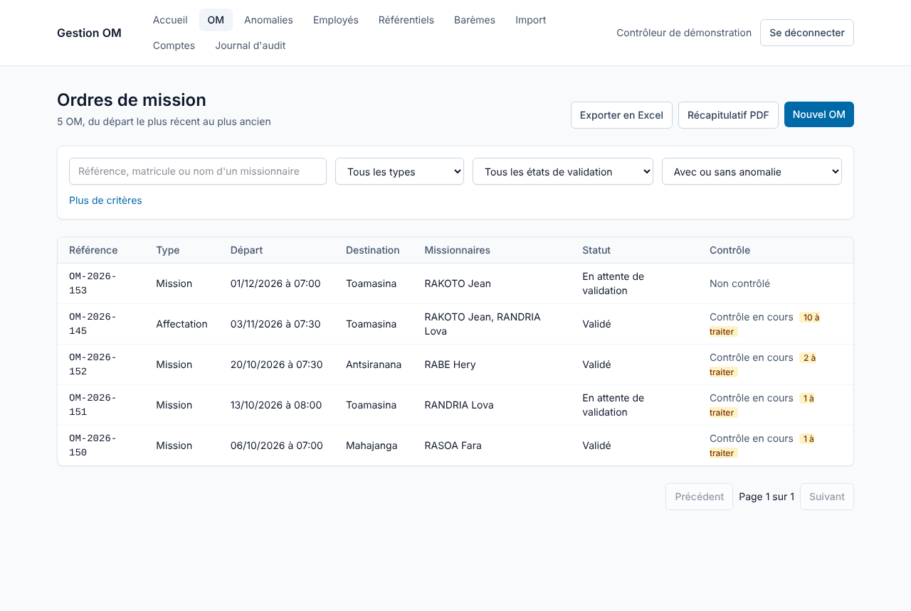
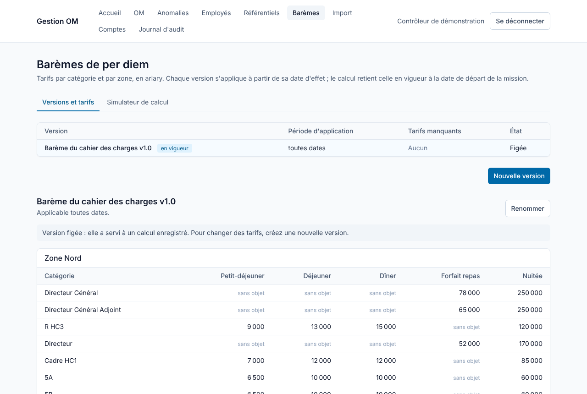

# Guide d'utilisation

Ce guide s'adresse aux contrôleurs qui utilisent Gestion OM au quotidien : saisir les ordres de mission, les contrôler, traiter les anomalies et produire les rapports.

## 1. Ce que fait l'application, et ce qu'elle ne fait pas

Gestion OM aide à vérifier les ordres de mission (OM). Trois idées guident tout l'outil :

- **On saisit l'OM tel qu'il figure sur le document**, même s'il contient une erreur. L'application n'empêche jamais d'enregistrer : un retour avant le départ, une quantité incohérente ou un validateur qui est aussi missionnaire s'enregistrent normalement.
- **L'application calcule et signale, elle ne corrige pas.** Elle calcule le per diem selon le barème et le place à côté du montant déclaré sur le document ; le montant déclaré n'est jamais modifié. Les écarts deviennent des anomalies.
- **C'est le contrôleur qui décide.** Une anomalie détectée automatiquement est seulement « proposée » : vous la confirmez ou l'écartez, puis vous la transmettez et la clôturez.

Tous les comptes ont les mêmes droits. Chaque opération importante est inscrite au journal d'audit avec son auteur et sa date.

## 2. Se connecter

Saisissez votre adresse e-mail et votre mot de passe, puis **Se connecter**.

- Après plusieurs essais infructueux, la connexion est bloquée quelques minutes : le message indique quand réessayer.
- Sans activité pendant deux heures, la session se ferme et l'écran de connexion revient. Pensez à enregistrer une saisie avant de vous absenter.
- **Se déconnecter** (en haut à droite) ferme la session, à faire sur un poste partagé.
- Pour changer votre mot de passe, cliquez sur votre nom en haut à droite (page **Mon compte**). Le mot de passe compte au moins 10 caractères, avec au moins une lettre et un chiffre.

Le menu donne accès aux pages : **Accueil** (tableau de bord), **OM**, **Anomalies**, **Employés**, **Référentiels**, **Barèmes**, **Import**, **Comptes** et **Journal d'audit**.

## 3. Le tableau de bord

La page d'accueil résume les OM enregistrés, hors OM supprimés, pour une période de départ : **Tout**, **Ce mois-ci**, **Mois précédent**, **Cette année**, ou des dates choisies.

- **OM enregistrés, en attente de validation, validés, présentant des anomalies.**
- **Per diem calculés** : seuls les calculs complets sont additionnés. Un calcul incomplet (tarif manquant, quantité invalide) est compté à part et n'est jamais pris pour zéro.
- **Per diem déclarés**, avec le nombre d'écarts avec le calcul.
- **Frais supplémentaires** et **indemnités d'affectation** déclarés.
- Répartition des OM par type, par état de validation et par état de contrôle, et des anomalies par catégorie.

**Récapitulatif PDF** et **Exporter en Excel** produisent le rapport et le classeur de la période affichée.

## 4. Saisir un OM

Page **OM**, bouton **Nouvel OM**. Le formulaire suit le document.

**Informations générales** : référence, type (Mission ou Affectation), objet, statut administratif, date et heure de départ et de retour, lieux de départ et de destination, durée déclarée, validateur et date de validation, observations. Tout peut rester vide si le document ne le porte pas : l'absence sera signalée au contrôle.

**Transport** : ajoutez les étapes dans l'ordre du trajet, à l'aller puis au retour, avec le moyen, les lieux et les frais de chaque étape. Les flèches changent l'ordre. Sans étape, l'OM n'a aucun moyen de transport.

**Frais et indemnité** : le montant global des frais supplémentaires de l'OM (quel que soit le nombre de missionnaires), l'indemnité d'affectation, et si le document la donne, la ventilation par nature (frais de déplacement, services de santé, imprévus, autres dépenses).

**Missionnaires** : **Ajouter un missionnaire**, puis cherchez-le par matricule ou par nom. Pour chacun :

- la **catégorie retenue sur l'OM**, pré-remplie depuis sa fiche, à corriger si le document en indique une autre ;
- le **per diem déclaré** sur le document ;
- les **quantités** de petits-déjeuners, déjeuners, dîners, forfaits repas et nuitées, **par zone** (Nord, Autres zones), et le **total déclaré** de chaque ligne s'il figure sur le document.

**Enregistrer l'OM** : l'application calcule aussitôt le per diem de chaque missionnaire avec le barème en vigueur à la date de départ.

Points à connaître :

- Pour un OM de type **Affectation**, la destination devient l'affectation de chaque missionnaire, à la date de départ ; l'historique de la fiche employé garde la trace de l'OM.
- Une même référence peut être saisie deux fois (doublon sur les documents) : le contrôle le signalera.
- **Modifier** reprend le formulaire ; **Supprimer** (avec confirmation) retire l'OM des listes, des indicateurs et des exports. La suppression est logique : l'OM reste en base, avec son état complet au journal d'audit, et l'historique d'affectation qu'il a produit est conservé.

## 5. Consulter un OM

La fiche d'un OM réunit le contrôle, les informations générales, le transport, les frais et chaque missionnaire.

Sous le titre, des pastilles indiquent le type, le statut administratif et l'état du contrôle (non contrôlé, contrôle en cours, sans anomalie, avec anomalies) avec le nombre d'anomalies à traiter.

La **durée** déclarée est affichée à côté de la durée selon les dates (jours calendaires, départ et retour compris : du 3 au 7 = 5 jours), en orange si elles diffèrent.

Pour chaque missionnaire, la fiche montre le **per diem déclaré**, le **per diem calculé** et l'**écart**, puis les quantités par zone et le total déclaré à côté de la somme des zones. **Détail du calcul** affiche chaque ligne : quantité × tarif = montant.

Si le calcul est **incomplet**, la raison est indiquée (catégorie manquante, tarif non renseigné dans le barème, absence de date de départ…). Un tarif non renseigné n'est jamais compté pour zéro.

**Rapport de contrôle PDF** produit la fiche complète de l'OM, avec les montants déclarés et calculés, le détail du calcul et les anomalies avec leur dernier commentaire.

## 6. Contrôler un OM et traiter les anomalies

### 6.1 Lancer le contrôle

Sur la fiche de l'OM, **Lancer le contrôle**. Les 30 règles du catalogue (voir § 12) examinent l'OM, sans le modifier, et proposent une anomalie pour chaque situation à vérifier. Relancer le contrôle ne crée pas de doublon : une situation déjà connue garde son anomalie.

Si l'OM est modifié après son contrôle, la liste des OM le marque « modifié depuis le contrôle » : relancez le contrôle pour mettre les anomalies à jour.

### 6.2 Lire une anomalie

Chaque anomalie indique son **état**, sa **priorité**, sa **catégorie** (A. Employés à H. Frais), le **code de la règle** et une description qui cite les données en cause, par exemple : « Rakoto Jean (R203) : per diem déclaré 500 000 Ar, calculé 503 000 Ar (déclaré inférieur de 3 000 Ar) ».

La priorité dépend de la nature : **haute** pour une erreur, **moyenne** pour une incohérence ou une donnée manquante, **basse** pour un point à vérifier. Vous pouvez la changer.

### 6.3 Traiter une anomalie

Les boutons sous chaque anomalie proposent les étapes possibles :

| État | Actions possibles |
|---|---|
| Proposée (par le contrôle) | **Confirmer** ; **Écarter** (motif obligatoire) |
| Confirmée | **Transmettre** ; **Clôturer** ; **Écarter** (motif obligatoire) |
| Transmise | **Clôturer** |
| Écartée ou clôturée | **Rouvrir** (elle redevient confirmée) |

Un commentaire facultatif peut accompagner chaque action. Les anomalies écartées ou clôturées sont repliées en bas de la liste (**Afficher les anomalies écartées ou clôturées**).

Quand la situation disparaît (l'OM a été corrigé et recontrôlé) :

- une anomalie seulement proposée est clôturée automatiquement ;
- une anomalie que vous aviez confirmée ou transmise est marquée « n'est plus détectée » : c'est à vous de la clôturer ou de l'écarter.

Une anomalie écartée n'est pas reproposée tant que la situation ne change pas.

### 6.4 Fiche d'une anomalie

**Fiche et historique** ouvre l'anomalie : OM et missionnaire concernés, règle, nature, dates de détection, actions, et tout l'historique (création, changements d'état, commentaires, modifications, nouvelles détections).

**Modifier les détails** permet de changer la priorité d'une anomalie automatique, et tous les champs d'un signalement manuel. **Ajouter un commentaire** complète l'historique sans changer l'état.

### 6.5 Signaler une anomalie à la main

Pour un constat que les règles ne couvrent pas (une facture qui ne correspond pas, par exemple), **Signaler une anomalie** sur la fiche de l'OM : catégorie, missionnaire concerné éventuel, nature, priorité, règle du catalogue concernée éventuelle, description, commentaire. Un signalement naît « confirmé » et porte votre nom.

## 7. La page Anomalies

L'onglet **Anomalies** liste les anomalies de tous les OM, à traiter d'abord. Filtres : texte (référence d'OM, missionnaire, description), état, priorité, catégorie, règle, origine (contrôle ou signalement), période de détection. **Exporter en Excel** produit la liste filtrée.

L'onglet **Contrôle par lot** contrôle en une fois les OM d'une période de départ, d'un type ou d'un statut, au choix tous les OM ou seulement ceux jamais contrôlés ou modifiés depuis. Le traitement se poursuit en arrière-plan ; le tableau montre son avancement et son résultat (anomalies proposées et clôturées).

L'onglet **Règles de contrôle** liste les 30 règles avec le nombre d'anomalies de chacune. Une règle peut être désactivée : elle n'est plus exécutée, et ses anomalies existantes restent telles quelles.

## 8. Rechercher, exporter et éditer des rapports

La page **OM** combine les critères du cahier des charges : référence ou missionnaire, type, état de validation, présence d'anomalies, missionnaire (nom ou matricule), catégorie et service du missionnaire, validateur, objet, destination, état du contrôle, périodes de départ et de retour. Les critères sur le missionnaire visent une même personne de l'OM.

Présence d'anomalies :

- **à traiter** : au moins une anomalie proposée, confirmée ou transmise ;
- **à traiter ou traitées** : les mêmes, plus les anomalies clôturées après confirmation ;
- **sans anomalie** : aucune des précédentes.

Les anomalies écartées ne comptent jamais.

Avec les critères de l'écran :

- **Exporter en Excel** produit un classeur avec une feuille par sujet (OM, missionnaires, frais, transports, anomalies) et une feuille qui rappelle les critères. Montants déclarés et calculés y figurent côte à côte, en nombres utilisables dans Excel.
- **Récapitulatif PDF** produit les indicateurs puis la liste des OM (500 OM au plus ; l'export Excel n'a pas de limite).

Chaque export et chaque rapport est inscrit au journal d'audit.

## 9. Employés

La page **Employés** liste les fiches, avec recherche par matricule, nom ou prénom et filtres par service, catégorie, affectation, habilitation à valider et état de la fiche.

**Nouvel employé** : seuls le matricule (unique) et le nom sont obligatoires ; une fiche incomplète s'enregistre et sera signalée au contrôle des OM qui la concernent. Champs : prénom, poste, service, catégorie (elle détermine le barème de per diem), affectation actuelle et sa date d'effet, compte missionné, **Habilité à valider les OM**, **Fiche active**.

La fiche montre aussi :

- l'**historique d'affectation**, de la plus récente à la plus ancienne, avec l'origine de chaque changement (saisie, import ou OM d'affectation) ;
- les **ordres de mission** où l'employé est missionnaire ou validateur.

Une fiche ne se supprime pas : décochez **Fiche active** pour la désactiver.

## 10. Import Excel

La page **Import** charge des lieux puis des employés depuis un fichier `.xlsx` ou `.csv` (5 Mo au plus).

1. **Télécharger le modèle** et le remplir (première ligne = en-têtes).
2. **Simuler** : l'application montre le bilan (créations, mises à jour, lignes rejetées avec leur motif, lignes à vérifier) sans rien enregistrer.
3. **Importer** pour enregistrer.

Une ligne invalide est rejetée sans bloquer les autres. Un matricule existant met la fiche à jour sans effacer ce qui est connu par une cellule vide. Les services absents sont créés.

## 11. Référentiels et barèmes

### 11.1 Référentiels

La page **Référentiels** gère les listes utilisées par les fiches et les OM : lieux (avec leur zone), catégories, services, objets de mission, moyens de transport (avec l'indication **Engendre des frais**). Les zones sont fixées par le cahier des charges. Un élément ne se supprime pas : **Désactiver** le retire des listes de saisie sans toucher aux données qui l'utilisent. Le code d'une catégorie ne change plus après sa création.

### 11.2 Barèmes

La page **Barèmes** gère les versions du barème de per diem. Chaque version s'applique de sa date d'effet jusqu'à la veille de la suivante ; le calcul d'un OM retient celle en vigueur à sa date de départ.

- **Nouvelle version** : libellé, date d'effet ; les tarifs de départ sont copiés de la version en vigueur à cette date, puis modifiables.
- Chaque tarif a trois états : un **montant** (0 compris), **vide** (non renseigné : le calcul sera incomplet, jamais compté pour 0) ou **sans objet** pour la catégorie (bouton à côté de la case).
- Une version qui a servi à un calcul enregistré est **figée** : ses tarifs et sa date ne changent plus, pour qu'un calcul enregistré ne change pas en silence.
- La colonne **Tarifs manquants** compte les tarifs non renseignés de chaque version.
- Le simulateur **Exemple du cahier des charges** calcule un per diem pour une catégorie, une date et des quantités, sans rien enregistrer. Exemple de référence : un R HC3, 3 jours en zone Nord puis 2 jours ailleurs, donne 503 000 Ar.

## 12. Les règles de contrôle

| Code | Catégorie | Nature | Ce que la règle relève |
|---|---|---|---|
| EMP-01 | Employés | Erreur | Fiche désactivée d'un missionnaire ou du validateur |
| EMP-02 | Employés | Donnée manquante | Catégorie manquante ou non reconnue, sur la fiche ou sur l'OM |
| EMP-03 | Employés | Donnée manquante | Informations administratives manquantes sur la fiche |
| VAL-01 | Validations | Erreur | Validateur parmi les missionnaires de l'OM |
| VAL-02 | Validations | Erreur | Validateur non habilité à valider |
| VAL-03 | Validations | Donnée manquante | OM validé sans validateur ou sans date de validation |
| OM-01 | OM | Erreur | Référence d'OM déjà utilisée |
| OM-02 | OM | Donnée manquante | Référence, type ou objet manquant |
| OM-03 | OM | Donnée manquante | Aucun missionnaire |
| OM-04 | OM | Donnée manquante | Lieu manquant ou sans zone |
| OM-05 | OM | Incohérence | Type d'OM incohérent avec l'objet de mission |
| DAT-01 | Chronologie | Erreur | Retour antérieur au départ |
| DAT-02 | Chronologie | Incohérence | Durée déclarée différente de la durée selon les dates |
| DAT-03 | Chronologie | Donnée manquante | Date ou durée manquante, nulle ou négative |
| DAT-04 | Chronologie | À vérifier | Quantités supérieures à la durée de la mission |
| TRA-01 | Transport | Erreur | Frais sur un moyen qui n'en engendre pas, ou frais de déplacement sans moyen payant |
| TRA-02 | Transport | Donnée manquante | Étape de transport incomplète |
| TRA-03 | Transport | Incohérence | Étapes qui ne s'enchaînent pas ou ne relient pas les lieux de l'OM |
| TRA-04 | Transport | À vérifier | Moyen payant sans frais, ou frais des étapes différents de la ventilation |
| AFF-01 | Affectations | Erreur | Indemnité d'affectation sur un OM de mission |
| AFF-02 | Affectations | Donnée manquante | OM d'affectation sans destination |
| AFF-03 | Affectations | Incohérence | Changement d'affectation et OM non concordants |
| AFF-04 | Affectations | Incohérence | Affectation actuelle différente de la dernière ligne de l'historique |
| PD-01 | Per diem | Erreur | Per diem déclaré différent du calculé |
| PD-02 | Per diem | Donnée manquante | Tarif absent, barème absent ou per diem déclaré manquant |
| PD-03 | Per diem | Incohérence | Consommation sans objet pour la catégorie |
| PD-04 | Per diem | Incohérence | Catégorie retenue sur l'OM différente de la fiche |
| PD-05 | Per diem | Incohérence | Quantité négative, ou total déclaré différent de la somme des zones |
| FRA-01 | Frais | Donnée manquante | Montant global manquant ou ligne de ventilation sans montant |
| FRA-02 | Frais | Incohérence | Ventilation ou frais des étapes incompatibles avec le montant global |

## 13. Comptes

La page **Comptes** liste tous les comptes contrôleurs. Vous pouvez créer un compte (**Nouveau compte** : nom, adresse e-mail, mot de passe), et modifier, désactiver ou réactiver **uniquement les comptes que vous avez créés**, y compris leur mot de passe : c'est ainsi qu'on aide un collègue qui a oublié le sien.

Un compte n'est jamais supprimé, il est désactivé : ses sessions sont fermées aussitôt, et les comptes qu'il avait créés vous sont confiés.

## 14. Journal d'audit

La page **Journal d'audit** liste les opérations sensibles, de la plus récente à la plus ancienne, avec leur auteur, leur objet et le détail (valeur avant → valeur après). Le filtre choisit une famille : OM, anomalies, contrôles et règles, connexions, comptes, employés, lieux, imports, exports, rapports, barèmes, sauvegardes. Les sauvegardes quotidiennes y apparaissent avec l'auteur « Tâche planifiée ».

## 15. Questions fréquentes

**Le per diem calculé ne correspond pas à ce que j'attendais.** Ouvrez **Détail du calcul** sur la fiche de l'OM : il montre le barème retenu, et pour chaque ligne la quantité, le tarif et le montant. Vérifiez la catégorie retenue sur l'OM et la répartition des quantités par zone.

**Le calcul est marqué « incomplet ».** Un élément manque : catégorie, date de départ, ou tarif non renseigné dans le barème. La raison est affichée ; complétez le barème ou l'OM puis enregistrez de nouveau l'OM.

**J'ai corrigé l'OM mais l'anomalie est toujours là.** Relancez le contrôle. Si vous aviez confirmé l'anomalie, elle est marquée « n'est plus détectée » : clôturez-la.

**J'ai écarté une anomalie par erreur.** Ouvrez-la et **Rouvrir** : elle redevient confirmée.

**Le message « Trop de tentatives » s'affiche.** Attendez le délai indiqué. Si cela se reproduit, prévenez l'administrateur du serveur.
