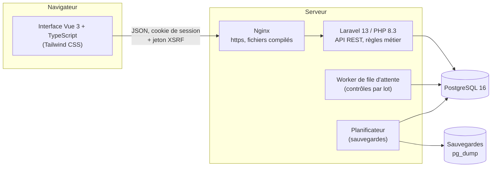
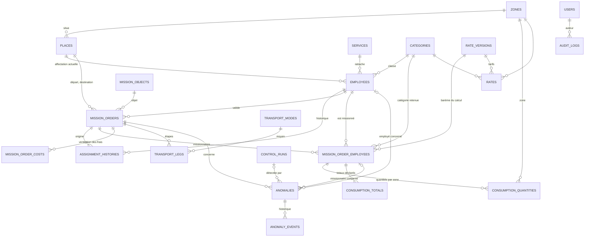
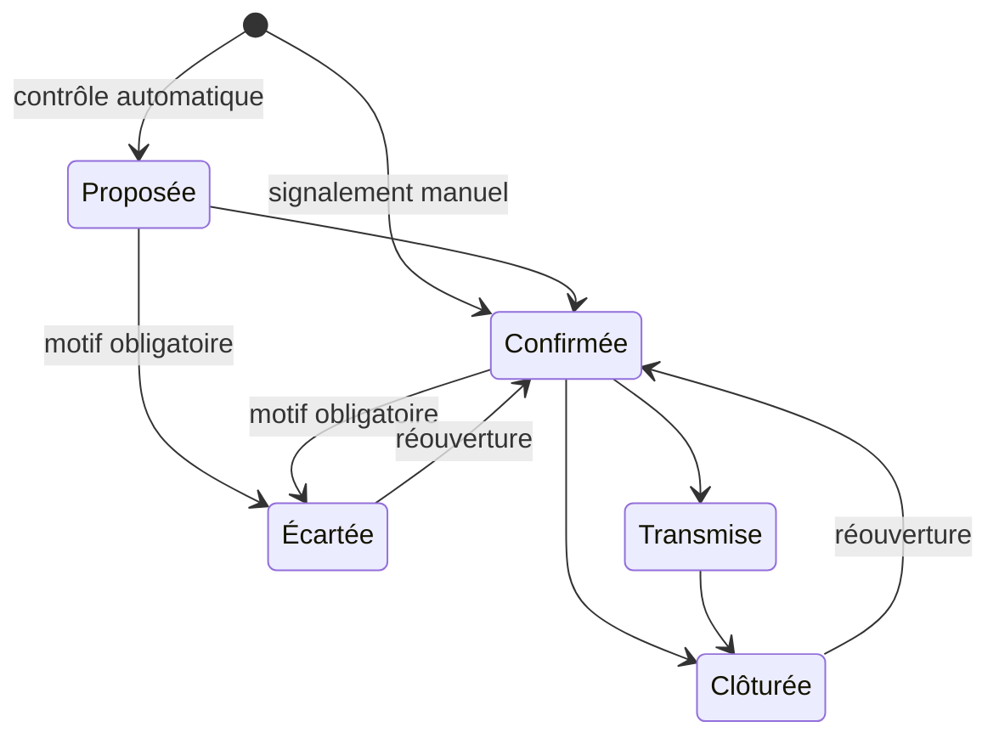

# Documentation technique

Ce document décrit l'architecture de Gestion OM, son modèle de données, son organisation en modules et ses mécanismes de sécurité. L'installation sur un serveur, les sauvegardes et l'exploitation courante sont décrites dans [exploitation.md](exploitation.md) ; la liste des routes de l'API et les règles de gestion détaillées sont dans le [README](../README.md).

## 1. Principes qui guident le code

Quatre principes du cahier des charges se retrouvent partout dans le code. Une modification qui les contredit est une régression, même si les tests passent.

1. **L'application signale, elle ne corrige ni ne bloque.** Un OM se saisit tel qu'il figure sur le document, même incohérent : retour avant départ, quantité négative, validateur missionnaire s'enregistrent. Seules les contraintes d'intégrité (références existantes, identifiants uniques) sont imposées, en base. Les écarts aux règles métier deviennent des anomalies que le contrôleur traite (§ 15.2).
2. **Le déclaré et le calculé coexistent.** Chaque montant existe en version déclarée (lue sur le document) et calculée. Le calcul ne remplace jamais le déclaré : `mission_order_employees` porte `declared_per_diem` et `calculated_per_diem` côte à côte.
3. **Un tarif manquant n'est jamais compté pour zéro.** Un tarif a trois états : un montant (0 compris), non renseigné, ou sans objet pour la catégorie. Un calcul qui rencontre un tarif non renseigné est marqué incomplet et dit pourquoi ; il n'entre pas dans les totaux.
4. **Les règles sont centralisées côté serveur.** Le per diem n'est calculé que par `App\PerDiem\PerDiemCalculator`, les anomalies ne sont détectées que par `App\Control\ControlEngine`, les critères de recherche ne sont définis que dans `App\Search\MissionOrderSearch`. L'interface affiche des résultats, elle ne recalcule rien.

Cas de référence, vérifié par les tests : un R HC3 qui passe 3 jours en zone Nord puis 2 jours ailleurs touche **503 000 Ar**.

## 2. Architecture

L'application suit l'architecture en trois couches du § 17 :



- **Présentation** : une application Vue 3 (une seule page) servie par Laravel, compilée par Vite dans `public/build`. Elle dialogue avec le serveur uniquement par l'API JSON.
- **Métier** : Laravel. Les contrôleurs HTTP valident la requête (classes `FormRequest` ou `validate()`), délèguent aux actions et aux services métier, et renvoient des ressources JSON. Aucune règle de gestion n'est appliquée seulement dans l'interface.
- **Données** : PostgreSQL. Le schéma est entièrement décrit par les migrations (`database/migrations`), qui créent aussi les valeurs du cahier des charges (zones, catégories, objets de mission, moyens de transport, barème d'origine).

Deux processus tournent à côté du serveur web : le worker de file d'attente (`php artisan queue:work`), qui exécute les contrôles par lot, et le planificateur (`php artisan schedule:run`, chaque minute), qui lance la sauvegarde quotidienne et son test de restauration.

### 2.1 Pile technique

| Couche | Technologie | Version |
|---|---|---|
| Serveur | PHP, Laravel, Laravel Sanctum (session SPA) | PHP 8.3, Laravel 13 |
| Base de données | PostgreSQL | 16 |
| Interface | Vue, TypeScript, Vue Router, Axios, Tailwind CSS, Vite | Vue 3.5, Tailwind 4 |
| Excel | openspout (lecture des imports, écriture des exports) | |
| PDF | dompdf (police DejaVu Sans embarquée, aucune ressource distante) | 3.1 |
| Tests | Pest (PHPUnit 12), sur PostgreSQL | Pest 4 |
| Qualité | Larastan (niveau 6), Pint, `vue-tsc` | |

## 3. Organisation du code

### 3.1 Serveur (`app/`)

| Dossier | Rôle |
|---|---|
| `Actions/` | Opérations métier qui écrivent : `SaveMissionOrder` (enregistre un OM, calcule le per diem de chaque missionnaire, met à jour les affectations d'un OM d'affectation), `SaveEmployee`, `CreateRateVersion`, `ReportAnomaly`, `TransitionAnomaly`, `UpdateAnomaly`, `DeactivateUser`. Chaque action s'exécute dans une transaction et écrit au journal d'audit. |
| `PerDiem/` | `PerDiemCalculator`, seul calcul du per diem : catégorie retenue sur l'OM, barème en vigueur à la date de départ, quantités par type de consommation et par zone. Rend un `PerDiemResult` (lignes, total par zone, complet ou non, motifs). |
| `Control/` | Moteur de contrôle. `RuleRegistry` liste les 30 règles (`Control/Rules`, une classe par règle) ; `ControlEngine` les exécute sur un OM, rapproche les situations relevées des anomalies existantes et en déduit le statut de contrôle (`ControlStatusResolver`). |
| `Search/` | `MissionOrderSearch` et `AnomalySearch` : validation des critères, requête, description lisible des critères (pour les exports et le journal). Une seule définition sert à la liste, au tableau de bord, aux exports et aux PDF. |
| `Reports/` | `Dashboard` (indicateurs) et le rendu PDF (`Pdf`, vues `resources/views/reports`). |
| `Exports/` | Classeurs Excel (`MissionOrdersExport`, `AnomaliesExport`) écrits ligne à ligne par `Workbook`. |
| `Imports/` | Import des lieux et des employés depuis `.xlsx` ou `.csv`, avec simulation. |
| `Backup/` | `DatabaseBackup` : sauvegarde `pg_dump`, manifeste, restauration d'essai. |
| `Jobs/` | `RunControlBatch`, contrôle d'un lot d'OM dans la file d'attente. |
| `Models/` | Modèles Eloquent ; le trait `Concerns\Auditable` journalise créations et modifications des référentiels, employés et tarifs. |
| `Enums/` | Valeurs codées (types d'OM, états d'anomalie, natures, priorités…) avec leur libellé français. |
| `Http/` | Contrôleurs de l'API (`Controllers/Api`), connexion (`Controllers/Auth`), requêtes validées, ressources JSON, middlewares (`EnsureUserIsActive`, `SecurityHeaders`). |
| `Console/Commands/` | Commandes `om:premier-compte`, `om:sauvegarde`, `om:verifier-sauvegarde`, `om:verifier-installation`. |
| `Support/` | `Audit` (point d'entrée unique du journal), `MissionDuration` (durée selon la convention retenue). |

### 3.2 Interface (`resources/js/`)

| Élément | Rôle |
|---|---|
| `pages/` | Une page par écran : tableau de bord, OM (liste, fiche, saisie), anomalies (liste, fiche, règles, contrôle par lot), employés, référentiels, barèmes, import, comptes, journal d'audit. |
| `components/` | Éléments réutilisés : actions sur une anomalie, signalement, sélection d'un employé, boutons de téléchargement, barres du tableau de bord. |
| `api.ts` | Client HTTP (Axios) : jeton XSRF, messages d'erreur en français (session expirée, trop de tentatives, erreur serveur), téléchargement des fichiers. |
| `referentials.ts`, `anomalies.ts`, `format.ts` | Listes de référence partagées, libellés des transitions d'anomalie, formats des montants et des dates. |
| `types.ts` | Types TypeScript des réponses de l'API. |

### 3.3 Ajouter une règle de contrôle

1. Créer une classe dans `app/Control/Rules` qui étend `App\Control\Rule` : `definition()` donne le code, la catégorie (§ 13.2), la nature et le libellé ; `check()` lit le `ControlContext` et rend des `Finding`, sans rien modifier.
2. L'ajouter à `RuleRegistry::RULES`, à sa place dans l'ordre des catégories.
3. Ajouter son cas dans `tests/Feature/Control/RulesTest.php` (situation relevée, et OM de référence sans anomalie) et mettre à jour le nombre de règles attendu.

La règle apparaît alors dans l'onglet « Règles de contrôle », où elle peut être désactivée sans toucher au code.

## 4. Modèle de données

### 4.1 Vue d'ensemble



### 4.2 Tables métier

| Table | Contenu | Contraintes notables |
|---|---|---|
| `zones` | Zones du barème : Nord, Autres. | `code` unique |
| `places` | Lieux, avec leur zone (facultative : un lieu sans zone est signalé par OM-04). | `name` unique |
| `categories` | Catégories professionnelles (DG à 5B). | `code` unique, non modifiable |
| `services`, `mission_objects`, `transport_modes` | Référentiels ; un moyen de transport indique s'il engendre des frais (`generates_costs`). | nom ou libellé unique |
| `employees` | Fiches employés : matricule, nom, prénom, poste, service, catégorie, affectation actuelle, compte, habilitation à valider. | `matricule` unique ; seuls matricule et nom sont obligatoires |
| `assignment_histories` | Chaque changement d'affectation, y compris le premier : ancienne et nouvelle affectation, date d'effet (inconnue possible), origine (saisie, import, OM), OM d'origine. | |
| `rate_versions` | Versions du barème ; la version d'origine n'a pas de date d'effet. `locked_at` fige une version dès qu'un calcul enregistré l'utilise. | `effective_from` unique |
| `rates` | Un tarif par version, catégorie, zone et type de consommation : `amount` (vide = non renseigné) et `is_applicable` (sans objet). | unique (version, catégorie, zone, type) |
| `mission_orders` | OM tels que saisis : référence (non unique, un doublon est signalé par OM-01), type, objet, dates et lieux, durée déclarée, frais supplémentaires (montant global), indemnité d'affectation, validateur et date de validation, statut administratif, statut de contrôle, date du dernier contrôle. Suppression logique (`deleted_at`). | |
| `mission_order_employees` | Missionnaires d'un OM : catégorie retenue, per diem déclaré, per diem calculé, calcul complet ou non, détail du calcul (`calculation`, JSON), barème retenu. | unique (OM, employé) |
| `consumption_quantities` | Quantités de repas et nuitées par type et par zone. | unique (missionnaire, type, zone) |
| `consumption_totals` | Totaux déclarés par type, comparés à la somme des zones (PD-05). | unique (missionnaire, type) |
| `mission_order_costs` | Ventilation facultative des frais supplémentaires par nature. | |
| `transport_legs` | Étapes de transport, ordonnées dans chaque sens (aller, retour), avec moyen, lieux et frais. | unique (OM, sens, position) |
| `control_rule_settings` | Activation de chaque règle de contrôle. | `code` unique |
| `control_runs` | Contrôles lancés (un OM ou un lot) : critères, avancement, anomalies proposées et clôturées. | |
| `anomalies` | Anomalies : OM, missionnaire ou employé concerné, catégorie, règle, cible (étape, type de repas…), origine (contrôle ou signalement), nature, priorité, état, description, dates de détection, de dernière détection, de disparition et de confirmation. | |
| `anomaly_events` | Historique de chaque anomalie : création, changement d'état, commentaire, modification, nouvelle détection. | |
| `users` | Comptes contrôleurs : créateur, actif ou désactivé. Mot de passe haché (bcrypt). | `email` unique |
| `audit_logs` | Journal d'audit : auteur, action, objet, valeurs avant et après (JSON), adresse IP, navigateur. | |

Les montants sont des entiers en ariary (`bigint`), les dates et heures sont locales (fuseau `Indian/Antananarivo`).

### 4.3 Règles d'intégrité

- Une référence vers un référentiel ou un employé est protégée (`RESTRICT`) : un référentiel ou une fiche utilisés ne se suppriment pas ; ils se désactivent.
- Les éléments propres à un OM (missionnaires, quantités, étapes, ventilation) suivent l'OM (`CASCADE`), mais un OM n'est jamais supprimé physiquement par l'application : la suppression est logique.
- Une anomalie garde son OM (`RESTRICT`), même supprimé logiquement ; son historique la suit.
- Le départ d'un compte n'efface rien : les références vers `users` passent à vide (`SET NULL`), et un compte n'est de toute façon jamais supprimé, seulement désactivé.

## 5. Traitements principaux

### 5.1 Enregistrement d'un OM

`SaveMissionOrder`, dans une transaction :

1. enregistre l'OM tel que saisi, ses étapes, sa ventilation et ses missionnaires ;
2. pour chaque missionnaire, retient le barème en vigueur à la date de départ (ou garde celui déjà retenu si la date n'a pas changé), calcule le per diem avec `PerDiemCalculator` et le range à côté du déclaré, puis fige la version du barème ;
3. pour un OM de type Affectation, inscrit la destination comme nouvelle affectation de chaque missionnaire, avec l'OM comme origine dans l'historique ;
4. journalise l'état complet de l'OM avant et après.

### 5.2 Contrôle

`ControlEngine::run()` charge l'OM et tout ce qu'il référence dans un `ControlContext`, exécute chaque règle active, puis rapproche chaque situation relevée des anomalies existantes par sa règle, l'employé concerné et sa cible :

- situation nouvelle : anomalie **proposée** ;
- situation déjà connue et encore à traiter : description mise à jour, date de dernière détection ;
- anomalie écartée ou clôturée : reproposée seulement si la situation a changé ou avait disparu entre-temps ;
- anomalie proposée qui n'est plus relevée : clôturée par le contrôle ; anomalie confirmée ou transmise qui n'est plus relevée : marquée « plus détectée », le contrôleur décide.

Le contrôle par lot (`RunControlBatch`) applique le même moteur à chaque OM retenu, dans la file d'attente, et suit son avancement dans `control_runs`.

### 5.3 États d'une anomalie



## 6. Sécurité

| Exigence (§ 17.3) | Mise en œuvre |
|---|---|
| Authentification | Session Laravel Sanctum (cookie `HttpOnly`, `SameSite=Lax`, `Secure` en production) ; durée de session 120 minutes. Un compte désactivé est refusé à la connexion et perd immédiatement l'accès s'il était connecté (middleware `active`). |
| Mots de passe | Hachage bcrypt (12 tours) ; 10 caractères minimum avec au moins une lettre et un chiffre ; jamais recopiés dans le journal. |
| Tentatives de connexion | 5 essais par minute pour un compte depuis une adresse, 20 par minute depuis une adresse (tous comptes confondus), 30 par heure pour un compte (toutes adresses). Le message ne dit pas si le compte existe. |
| Autorisations | Toute l'API exige une session active. Un compte ne modifie que les comptes qu'il a créés (`UserPolicy`). |
| Abus et déni de service | 600 requêtes par minute et par compte sur l'API ; 20 exports ou PDF par minute et par compte. |
| Validation | Toute donnée reçue est validée côté serveur (types, existence des références, formats), indépendamment de l'interface. |
| Injection SQL | Requêtes construites par l'ORM avec paramètres liés ; les rares fragments SQL écrits à la main sont constants ou paramétrés. Les caractères spéciaux d'une recherche sont traités comme du texte. |
| XSS | Vue échappe tout texte affiché (aucun `v-html`) ; politique de contenu stricte (voir ci-dessous) ; un texte commençant par « = » reste un texte dans les exports Excel. |
| CSRF | Jeton XSRF de Sanctum sur toute requête qui modifie ; cookie `SameSite=Lax`. |
| HTTPS | En production, les URL sont forcées en https, le cookie de session n'est envoyé qu'en https, et l'en-tête HSTS (un an) est envoyé sur les requêtes chiffrées. |
| En-têtes | `Content-Security-Policy` (scripts, styles et connexions limités au site lui-même, aucun cadre), `X-Frame-Options: DENY`, `X-Content-Type-Options: nosniff`, `Referrer-Policy: same-origin`, `Permissions-Policy`, `Cross-Origin-Opener-Policy`. `X-Powered-By` est retiré. |
| Erreurs | En production (`APP_DEBUG=false`), une erreur serveur renvoie un message générique ; le détail ne va qu'au journal du serveur. |
| Secrets | Dans `.env`, hors du dépôt ; mot de passe de la base transmis à `pg_dump` par l'environnement, jamais en ligne de commande. Sauvegardes et manifestes lisibles par leur seul propriétaire (`0600`). |
| Traçabilité | Journal d'audit (`App\Support\Audit::record()`) : connexions et échecs, comptes, imports, référentiels, employés, barèmes et tarifs avec la valeur précédente, OM avant et après, contrôles, anomalies, exports et rapports, sauvegardes et vérifications. |
| Dépendances | `composer audit` et `npm audit` chaque semaine et à chaque changement des dépendances (workflow `Dependencies`). |
| Sauvegardes | Sauvegarde quotidienne et restauration d'essai automatique (voir [exploitation.md](exploitation.md)). |

Les limites de tentatives et les en-têtes sont définis dans `AppServiceProvider::configureRateLimiting()` et `App\Http\Middleware\SecurityHeaders`.

## 7. Qualité

Chaque pull request passe par l'intégration continue (`.github/workflows/ci.yml`) :

```sh
vendor/bin/pint --test                           # style PHP
vendor/bin/phpstan analyse --memory-limit=1G     # analyse statique (niveau 6)
vendor/bin/pest                                  # tests, sur PostgreSQL 16
npm run typecheck                                # types TypeScript
npm run build                                    # compilation de l'interface
```

Les tests tournent sur PostgreSQL, pas sur SQLite : les requêtes, contraintes et sauvegardes sont vérifiées sur le même moteur qu'en production. Le détail des tests et des résultats est dans [rapport-de-tests.md](rapport-de-tests.md).
